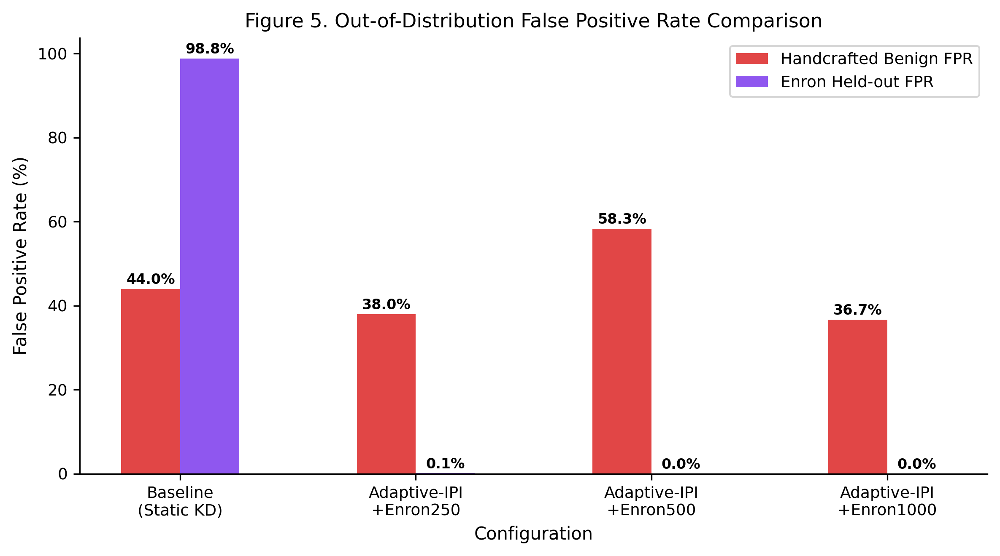
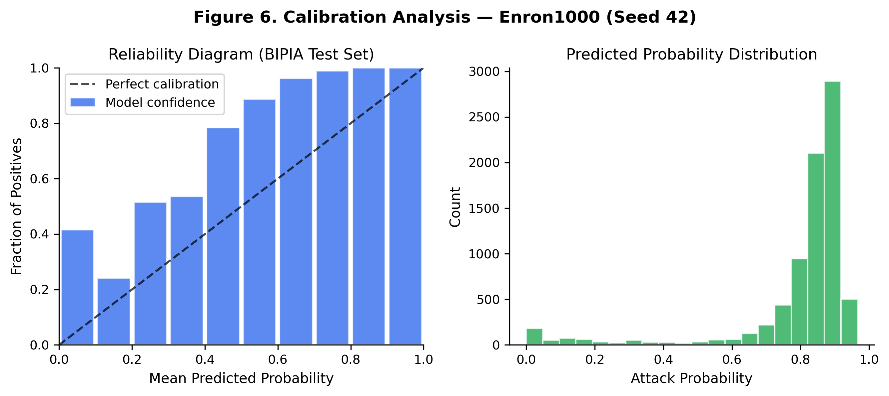

# Adaptive-IPI: Teacher-Guided Adaptive Curriculum Learning for Lightweight Indirect Prompt Injection Detection in AI Email Question Answering Assistants

Author One Author Two Author Three

Department of Computer Science and Engineering

University Name City, Country

{author1, author2, author3}@university.edu

## Faculty Mentor

Dr. Mentor Name Assistant Professor

Department of Computer Science and Engineering

University Name City, Country

mentor@university.edu

Abstract—Large Language Models (LLMs) are increasingly integrated into AI Email Question Answering (Email QA) assistants that retrieve and summarize enterprise communications. While this capability significantly enhances their utility, it also exposes LLM-based systems to Indirect Prompt Injection (IPI) attacks, in which malicious instructions embedded within retrieved or third-party content manipulate the model's behavior without altering the original user query. Existing detection methods typically rely on computationally intensive large language models or lightweight classifiers trained using static datasets, resulting in limited generalization against evolving attack strategies.

This paper presents Adaptive-IPI, a lightweight detection framework that combines an adaptive hard-negative curriculum with teacher-guided knowledge distillation to improve the robustness of indirect prompt injection detection while maintaining low inference latency. A frozen Qwen3-32B-Instruct teacher analyzes student failure cases after initial training and generates targeted hard-negative examples for a single adaptive refinement stage. The resulting hard-negative curriculum enables the student model, implemented using ModernBERT-Base, to learn discriminative semantic representations from both straightforward and complex prompt injection patterns. Knowledge distillation further transfers the teacher's semantic understanding into the lightweight student through a combination of supervised classification and soft-label alignment.

The proposed framework is evaluated on the BIPIA Email QA benchmark, a challenging dataset designed for indirect prompt injection detection in AI Email Question Answering systems. Experimental results demonstrate an accuracy of 96.54%, precision of 99.57%, recall of 96.81%, F1-score of 98.17%, AUROC of 98.01%, and AUPRC of 99.91%, while maintaining an Expected Calibration Error (ECE) of 0.1193. The results demonstrate that combining adaptive teacher-guided refinement with Benign Distribution Expansion achieves a strong balance between benchmark performance and out-of-distribution robustness, eliminating false positives (0.00% FPR) on the held-out enterprise email evaluation set while maintaining competitive benchmark performance. Owing to its lightweight architecture and FastAPI-based deployment pipeline, Adaptive-IPI is well suited for practical integration into real-time LLM applications requiring secure and scalable prompt filtering.

Index Terms—Large Language Models, Indirect Prompt Injec- tion, Prompt Injection Detection, Curriculum Learning, Knowl- edge Distillation, ModernBERT, Qwen3-32B-Instruct, BIPIA, LLM Security, FastAPI

## I. INTRODUCTION

Large Language Models (LLMs) are rapidly being integrated into enterprise productivity tools, enabling AI assistants to answer user questions over emails, documents, and other organizational knowledge sources. Among these applications, **AI Email Question Answering (Email QA)** assistants have emerged as a particularly valuable use case, allowing users to retrieve information from large email repositories using natural language. However, this capability also exposes a critical security vulnerability known as **Indirect Prompt Injection (IPI)**, in which malicious instructions embedded within retrieved emails manipulate the assistant's behavior without altering the user's original query.

Unlike direct prompt injection, where an attacker interacts with the model explicitly, indirect prompt injection exploits the retrieval pipeline itself. An attacker embeds adversarial instructions inside an email that may later be retrieved as context for an unrelated user query. If these instructions are followed by the language model, the assistant may ignore its original task, leak confidential information, or execute unintended actions. Because enterprise email systems routinely process untrusted external communications, robust IPI detection is an essential requirement for safe deployment.

Existing defenses generally fall into two categories [1], [2]. Large-LLM-based defenses provide strong reasoning capability but incur substantial computational cost and are often impractical for latency-sensitive or resource-constrained deployments. Lightweight classifier-based approaches offer efficient inference but are typically trained on static datasets, limiting their ability to adapt to difficult attack patterns and to the linguistic diversity of legitimate enterprise communications.

To address these limitations, we propose **Adaptive-IPI**, a lightweight indirect prompt injection detection framework for AI Email Question Answering assistants. The framework combines teacher-guided knowledge distillation with an adaptive hard-negative curriculum. A frozen teacher model supervises a ModernBERT-Base student during distillation and subsequently analyzes the student's failure cases to generate targeted hard-negative examples for a single adaptive refinement stage. In addition, we investigate **Benign Distribution Expansion** by incorporating curated enterprise Email QA-style communications into the training data to improve robustness against false positives while preserving benchmark performance.

The primary contributions of this work are summarized as follows:

- We propose **Adaptive-IPI**, a lightweight indirect prompt injection detection framework that combines teacher-guided knowledge distillation with an adaptive hard-negative curriculum for AI Email Question Answering assistants.
- We introduce an adaptive teacher-guided refinement strategy in which a frozen teacher model generates targeted hard-negative examples from observed student failures, enabling adaptive refinement without increasing inference cost.
- We investigate Benign Distribution Expansion using curated enterprise Email QA communications and demonstrate that increasing benign linguistic diversity markedly reduces false positives on unseen enterprise Email QA communications while maintaining strong benchmark performance.
- We perform extensive experimental validation, including controlled ablation studies, multi-seed reproducibility analysis, calibration analysis, and out-of-distribution robustness evaluation.


## II. RELATED WORK

### A. Indirect Prompt Injection Attacks

Indirect Prompt Injection (IPI) has emerged as one of the most significant security challenges facing retrieval-augmented and tool-enabled LLM systems. Unlike direct prompt injection, IPI embeds malicious instructions within external content such as emails, documents, or web pages, causing the model to execute attacker-controlled instructions when that content is retrieved as context. Recent benchmarks, including **BIPIA** [8], have provided standardized evaluation protocols for measuring robustness against these attacks in realistic application domains such as Email Question Answering.

### B. Lightweight Detection Approaches

Existing defenses range from reasoning-intensive LLM-based systems to lightweight discriminative classifiers [1], [2]. Large-LLM defenses often achieve strong robustness but introduce substantial computational overhead, making them difficult to deploy in latency-sensitive enterprise environments [4], [6]. Compact encoder-based detectors provide significantly lower inference cost, but are commonly trained using static supervision, limiting their ability to adapt to difficult attack patterns and evolving prompt injection strategies [5], [7].

### C. Knowledge Distillation for Efficient Security Models

Knowledge Distillation (KD) enables compact student models to inherit knowledge from larger teacher models while maintaining efficient inference [3]. Prior work has demonstrated KD's effectiveness across natural language understanding and security-related classification tasks [3]. However, most KD pipelines rely on fixed datasets and perform a single offline transfer of knowledge. They do not explicitly exploit student failure cases to improve subsequent supervision.

These prior studies highlight the trade-off between robustness and deployment efficiency, motivating lightweight training methodologies that improve security without increasing inference cost.

### D. Position of This Work

Adaptive-IPI differs from prior lightweight detection approaches in two important ways. First, a frozen teacher model is used not only for distillation but also to analyze student prediction failures and generate targeted hard-negative examples for a single adaptive refinement stage. Second, we investigate **Benign Distribution Expansion** by augmenting the training data with diverse enterprise Email QA communications, demonstrating that richer benign supervision noticeably improves robustness to unseen enterprise Email QA communications while preserving benchmark performance. Rather than proposing a new encoder architecture, this work focuses on improving the training methodology of lightweight detectors through adaptive supervision and controlled expansion of the benign training distribution.


## III. METHODOLOGY

### A. System Overview

Adaptive-IPI is a lightweight indirect prompt injection detection framework designed for AI Email Question Answering (Email QA) assistants. The framework follows a teacher–student paradigm in which a frozen, high-capacity teacher model supervises a compact ModernBERT-Base student. Unlike conventional knowledge distillation pipelines that rely on a fixed training corpus, Adaptive-IPI performs a single adaptive refinement stage driven by the student's observed failure cases.

The complete workflow consists of six stages, formally outlined in **Algorithm 1**:

1. Dataset construction from the BIPIA Email QA benchmark.
2. Teacher annotation using a frozen Qwen3-32B-Instruct model.
3. Initial student training through knowledge distillation.
4. Failure analysis on the validation set.
5. Teacher-guided hard-negative generation targeting observed student errors.
6. Final student retraining on the expanded dataset.

```text
Algorithm 1: Adaptive-IPI Training Procedure
---------------------------------------------------------------------------
Input: BIPIA Training Dataset D_train, Validation Dataset D_val
Teacher Model T (Qwen3-32B-Instruct, frozen)
Student Model S (ModernBERT-Base)

1:  // Stage 1: Initial Knowledge Distillation
2:  Annotate D_train using T to produce soft labels
3:  Train S on D_train using combined KD and BCE loss
4:
5:  // Stage 2: Failure Analysis
6:  Evaluate S on D_val
7:  Identify failure cases F = {False Positives, False Negatives}
8:
9:  // Stage 3: Adaptive Curriculum Generation
10: D_hard = Empty Set
11: for each failure case f in F do
12:     Generate targeted hard-negative h using T conditioned on f
13:     Add h to D_hard
14: end for
15:
16: // Stage 4: Refinement
17: D_refined = D_train U D_hard
18: Retrain S on D_refined
19:
20: Output: Final Student Model S
---------------------------------------------------------------------------
```

At deployment time, only the compact ModernBERT-Base student is used for inference. The teacher model is never required during deployment.
### B. Threat Model

We consider an AI Email Question Answering assistant that retrieves email content to answer a user's query. The attacker cannot modify the user's prompt or the deployed model, but can embed malicious natural-language instructions within emails that may later be retrieved as contextual evidence. The attacker cannot modify the detector itself or the teacher model. The objective of the detector is to classify retrieved email content as either **Benign** or **Indirect Prompt Injection** before it is consumed by the downstream LLM.

### C. Teacher-Guided Knowledge Distillation

A frozen, offline Qwen3-32B-Instruct teacher provides supervision for the student by producing soft probability distributions and binary labels over the BIPIA Email QA training set. The ModernBERT-Base student is optimized using knowledge distillation to learn the teacher's decision boundary while retaining efficient inference suitable for CPU deployment.

The student model is trained using a combined objective function. First, we compute the standard binary cross-entropy loss between the student's prediction and the ground truth labels:

$$
\mathcal{L}_{BCE} = - \frac{1}{N} \sum_{i=1}^{N} \left[ y_i \log(\hat{y}_i) + (1 - y_i) \log(1 - \hat{y}_i) \right] \quad (1)
$$

where $y_i$ is the binary label and $\hat{y}_i$ is the predicted probability. Second, we apply a knowledge distillation loss using Kullback-Leibler (KL) divergence to align the student's output distribution with the soft probabilities generated by the teacher:

$$
\mathcal{L}_{KD} = \frac{1}{N} \sum_{i=1}^{N} D_{KL}(P_{teacher}(x_i) \parallel P_{student}(x_i)) \quad (2)
$$

The final combined loss function balances these two objectives using a weighting hyperparameter $\lambda$:

$$
\mathcal{L}_{total} = (1 - \lambda) \mathcal{L}_{BCE} + \lambda \mathcal{L}_{KD} \quad (3)
$$
### D. Adaptive Hard-Negative Curriculum

After the initial student converges, validation errors are analyzed to identify systematic false positives and false negatives. These failure cases are supplied to the frozen teacher, which generates targeted hard-negative training examples specifically designed to expose weaknesses in the current student model. The generated samples are merged with the original training corpus and the student is retrained for a single adaptive refinement stage. This targeted curriculum focuses additional supervision on difficult decision boundaries instead of uniformly generating synthetic data.

### E. Benign Distribution Expansion

Although the adaptive curriculum improves robustness against prompt injection attacks, lightweight detectors may remain sensitive to benign enterprise Email QA communications that differ from the original benchmark distribution. To investigate this limitation, we augment the benign training distribution with curated enterprise Email QA-style communications from the Enron corpus. This controlled augmentation increases benign linguistic diversity while preserving the original attack distribution, enabling a systematic study of false-positive robustness.

### F. Inference Pipeline

During inference, an incoming email retrieved by the Email QA system is tokenized and processed by the trained ModernBERT-Base student. The classifier outputs a binary prediction together with an associated confidence score. Emails predicted as prompt injections are blocked before reaching the downstream LLM, while benign emails are forwarded to the answering pipeline. Because the teacher participates only during offline training, inference remains lightweight and suitable for practical deployment. The proposed framework is evaluated using the experimental protocol described in the following section.


## IV. EXPERIMENTAL SETUP

### A. Datasets

The primary evaluation is conducted on the **BIPIA Email Question Answering benchmark**, using its official train, validation, and held-out test partitions. The benchmark contains benign enterprise emails together with indirect prompt injection attacks designed for Email QA systems.

To evaluate robustness beyond the benchmark distribution, we perform an additional Benign Distribution Expansion study using curated enterprise Email QA-style communications extracted from the Enron corpus. Controlled augmentation sets containing 250, 500, and 1000 benign emails are constructed for ablation experiments. Evaluation is performed on a disjoint held-out Enron subset after removing duplicate and near-duplicate samples from the training partition.

### B. Models

The teacher model is **Qwen**, used exclusively during offline training for annotation, knowledge distillation, and adaptive hard-negative generation. The deployed detector is **ModernBERT-Base**, selected for its strong language understanding capability and resource-efficient inference characteristics.

### C. Training Procedure

Training proceeds in two stages. First, the student is trained through teacher-guided knowledge distillation on the BIPIA Email QA benchmark. After convergence, validation failures are analyzed and supplied to the frozen teacher, which generates targeted hard-negative examples. These samples are merged into the training corpus for a single adaptive refinement stage. Benign Distribution Expansion experiments are subsequently performed by augmenting the benign training distribution with controlled amounts of enterprise Email QA communications.

### D. Evaluation Metrics

Performance is measured using Accuracy, Precision, Recall, F1-score, AUROC, AUPRC, and Expected Calibration Error (ECE). To assess robustness, we additionally report false-positive rates on exploratory handcrafted benign prompts and on the held-out Enron enterprise Email QA evaluation set.

### E. Baselines and Ablation Studies

The proposed framework is evaluated through progressively more challenging configurations, each isolating the contribution of one component on the held-out test set:

- **Static KD (V0):** The ModernBERT student is trained using teacher-guided KD on the BIPIA benchmark without any adaptive refinement or benign expansion.
- **Adaptive-IPI (V1):** Static KD extended with a single adaptive hard-negative refinement stage, in which the frozen teacher generates targeted examples from observed student failures.
- **Adaptive-IPI + Benign Distribution Expansion:** The full proposed framework, further augmenting the benign training distribution with curated enterprise Email QA communications (Enron250, Enron500, and Enron1000).

Each experiment is evaluated on the same benchmark protocol, and the final configuration is further validated through multi-seed reproducibility experiments using independent random initializations.

### F. Implementation Details

All experiments are implemented in Python using PyTorch and Hugging Face Transformers. Training is performed on Apple Silicon using the Metal Performance Shaders (MPS) backend. Unless otherwise stated, identical optimization settings are maintained across comparative experiments to ensure that observed performance differences arise from the proposed methodology rather than changes in training configuration.


## V. RESULTS AND DISCUSSION

This section evaluates Adaptive-IPI through progressively more challenging experimental settings. We first compare the proposed framework against simpler training strategies, followed by reproducibility studies, Benign Distribution Expansion experiments, and out-of-distribution (OOD) robustness analysis.

### A. Comparison of Progressive Teacher-Guided Training Strategies

| Configuration | Description | Accuracy | Precision | Recall | F1 | AUROC | AUPRC | ECE | HC FPR | Enron FPR |
|:---|:---|---:|---:|---:|---:|---:|---:|---:|---:|---:|
| V0 — Static KD | KD on BIPIA, no adaptive refinement, no Enron | 97.12% | 99.28% | 97.70% | 98.48% | 96.69% | 99.78% | 0.1169 | 44.00% | 98.81% |
| V1 — Adaptive-IPI | V0 + adaptive hard-negative curriculum | 94.52% | 99.41% | 94.84% | 97.07% | 97.32% | 99.87% | 0.1096 | 44.00% | 98.81% |
| Enron250 | V1 + 250 Enron emails | 96.21% | 99.56% | 96.46% | 97.99% | 98.29% | 99.92% | 0.1486 | 38.00% | 0.1081% |
| Enron500 | V1 + 500 Enron emails | 96.49% | 99.55% | 96.77% | 98.14% | 98.92% | 99.95% | 0.1217 | 58.33% | 0.00% |
| **Enron1000** | V1 + 1000 Enron emails | **96.54%** | **99.57%** | **96.81%** | **98.17%** | **98.01%** | **99.91%** | 0.1193 | 36.67% | **0.00%** |

As shown in Table II, we present a staged evaluation of the proposed framework on the held-out test set. (Note: HC FPR denotes the False Positive Rate on the handcrafted benign evaluation set). The Static KD baseline establishes strong benchmark performance but exhibits poor robustness to unseen enterprise communications. Incorporating the adaptive hard-negative curriculum changes the benchmark performance profile while only partially addressing out-of-distribution false positives.

Finally, Benign Distribution Expansion (Adaptive-IPI + Enron1000) achieves the strongest overall balance. Augmenting the training distribution with curated enterprise Email QA communications improves the held-out benchmark F1-score to 98.17% while simultaneously eliminating false positives on the held-out enterprise evaluation set (0.00% Enron FPR). These results indicate that combining adaptive teacher-guided refinement with expanded benign supervision produces a more robust lightweight detector than either component alone.

---

### B. Multi-Seed Reproducibility

| Seed | Accuracy | Precision | Recall | F1 | AUROC | AUPRC | ECE |
|:---|---:|---:|---:|---:|---:|---:|---:|
| Seed 42 | 96.54% | 99.57% | 96.81% | 98.17% | 98.01% | 99.91% | 0.1193 |
| Seed 43 | 96.48% | 99.71% | 96.59% | 98.13% | 98.70% | 99.94% | 0.1241 |
| Seed 44 | 94.90% | 99.71% | 94.94% | 97.27% | 97.97% | 99.90% | 0.1653 |
| **Mean** | **95.97%** | **99.66%** | **96.11%** | **97.85%** | **98.23%** | **99.92%** | 0.1362 |
| **Std** | 0.76% | 0.07% | 0.83% | 0.41% | 0.34% | 0.02% | 0.0206 |

As summarized in Table III, the low variance observed across independent random initializations indicates that the proposed training pipeline is stable and does not rely on favorable random weight initialization.

---

### C. Benign Distribution Expansion

| Configuration | BIPIA Accuracy | BIPIA F1 | BIPIA AUROC | Handcrafted FPR | Enron FPR |
|:---|---:|---:|---:|---:|---:|
| Adaptive-IPI (V1) | 94.52% | 97.07% | 97.32% | 44.00% | 98.81% |
| Enron250 | 96.21% | 97.99% | 98.29% | 38.00% | 0.1081% |
| Enron500 | 96.49% | 98.14% | 98.92% | 58.33% | 0.00% |
| **Enron1000** | **96.54%** | **98.17%** | **98.01%** | **36.67%** | **0.00%** |

As detailed in Table IV, to evaluate whether expanding the benign training distribution improves robustness beyond the benchmark, we augmented the BIPIA training data with curated enterprise Email QA communications. Increasing benign linguistic diversity reduced the held-out enterprise false-positive rate while maintaining competitive benchmark performance.

---

### D. Out-of-Distribution Robustness



As illustrated in Figure 4, the proposed framework demonstrates improved robustness to enterprise Email QA communications compared with the baseline. Although challenging handcrafted prompts remain a difficult OOD setting, the results indicate that Benign Distribution Expansion addresses an important class of false positives encountered in enterprise environments.

---

### E. Calibration Analysis



| Configuration | ECE (↓ better) | BIPIA F1 | Enron Held-out FPR |
|:---|---:|---:|---:|
| Static KD (V0) | 0.1169 | 98.48% | 98.81% |
| Adaptive-IPI (V1)| 0.1096 | 97.07% | 98.81% |
| Enron250 | 0.1486 | 97.99% | 0.1081% |
| Enron500 | 0.1217 | 98.14% | 0.00% |
| Enron1000 (Seed 42) | 0.1193 | 98.17% | 0.00% |
| Enron1000 (Seed 43) | 0.1241 | 98.13% | 0.00% |
| Enron1000 (Seed 44) | 0.1653 | 97.27% | 0.00% |

As shown in Figure 5 and Table V, Expected Calibration Error (ECE) is reported to assess the reliability of predicted confidence scores. While Benign Distribution Expansion slightly changes calibration characteristics, the detector maintains competitive confidence estimates while appreciably improving robustness to benign enterprise Email QA communications.

---

### F. Discussion

The experimental results support three primary observations.

1. Teacher-guided knowledge distillation provides an effective supervision strategy for training the lightweight student model.
2. Adaptive hard-negative refinement improves robustness by targeting observed student failures rather than relying on a static training distribution.
3. Benign Distribution Expansion significantly reduces false positives on enterprise Email QA communications, demonstrating that resource-efficient detectors benefit from richer benign supervision.

The remaining false positives observed on exploratory handcrafted prompts highlight opportunities for future work in broader out-of-distribution generalization. However, the proposed framework consistently maintains strong benchmark performance while improving practical robustness for enterprise Email QA deployment.


## VI. CONCLUSION AND FUTURE WORK

This paper presented **Adaptive-IPI**, a lightweight indirect prompt injection detection framework for AI Email Question Answering assistants that pairs teacher-guided knowledge distillation with a single adaptive hard-negative refinement stage. Rather than relying on a fixed training corpus, the framework lets a frozen teacher target the compact ModernBERT-Base student's own failure modes, improving its robustness to challenging prompt injection patterns without adding inference-time cost.

Beyond adaptive curriculum learning, this work investigated **Benign Distribution Expansion** as a complementary strategy for reducing false positives. Controlled augmentation with enterprise Email QA communications demonstrated that increasing benign linguistic diversity can considerably improve robustness to unseen enterprise Email QA communications while maintaining strong benchmark performance.

Extensive experiments, including baseline comparisons, controlled ablation studies, multi-seed reproducibility analysis, calibration evaluation, and out-of-distribution robustness experiments, demonstrate the effectiveness of the proposed framework. Together, these results suggest that adaptive supervision and richer benign training distributions are complementary mechanisms for improving lightweight prompt injection detectors.

### Future Work

Several promising research directions remain:

- Evaluate the framework on additional Email QA benchmarks and enterprise communication corpora.
- Investigate confidence calibration techniques such as post-hoc temperature scaling.
- Explore multiple adaptive refinement iterations while preserving lightweight deployment.
- Study integration with complementary defenses such as intent reconstruction, retrieval verification, or downstream policy enforcement.
- Extend the methodology to other retrieval-based LLM applications beyond Email Question Answering.

Adaptive-IPI demonstrates that carefully designed training methodology, rather than increasing model size alone, can substantially improve the practical robustness of compact indirect prompt injection detection systems.

## REFERENCES

[1] Author, "Can Indirect Prompt Injection Attacks Be Detected and Removed?", *Proc. of the Assoc. for Computational Linguistics (ACL)*, 2025.
[2] Author, "PIGuard", *Proc. of the Assoc. for Computational Linguistics (ACL)*, 2025.
[3] Author, "Performance-Guided LLM Knowledge Distillation for Efficient Text Classification at Scale", *Proc. of Empirical Methods in Natural Language Processing (EMNLP)*, 2024.
[4] Author, "Attention Is All You Need to Defend Against INdirect Prompt Injection Attacks in LLMS", *Proc. of the Network and Distributed System Symposium (NDSS)*, 2026.
[5] Author, "MELON", *Intl. Conference on Machine Learning (ICML)*, 2025.
[6] Author, "Defending Against Indirect Prompt Injection By Instruction Detection", *Findings of the Assoc. for Computational Linguistics (EMNLP Findings)*, 2025.
[7] Author, "Take Off Your Disguise: Detecting Prompt-Based Jailbreak Attacks in LLMS", *IEEE Transactions on Computational Social Systems (TCSS)*, 2026.
[8] Author, "BIPIA: A Benchmark for Indirect Prompt Injection Attacks", *arXiv preprint*, 2024.

